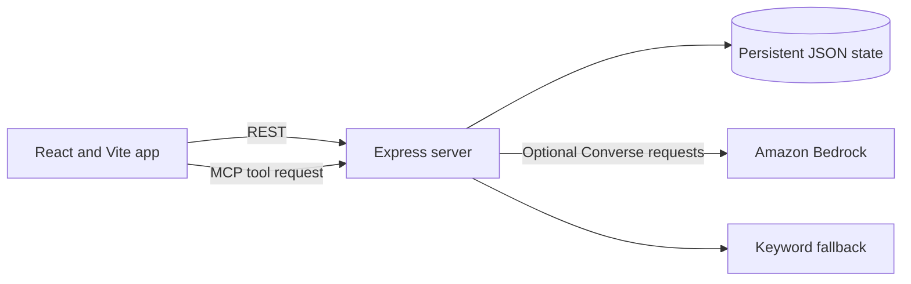

# Crocademy - StudyPilot

StudyPilot is a study planner with Croc, a voice-first co-pilot. Students can organize assignments, build study plans, track topic confidence, and run focus sessions. The app saves shared state on its local Express server and exposes the same study actions through Model Context Protocol (MCP) tools.

> No public demo URL is configured in this repository. Run the project locally with the steps below.

## Features

- Create, complete, and reschedule tasks; build multi-day study plans.
- Run persistent focus timers and track study sessions, progress, and topic confidence.
- Talk to Croc using browser speech recognition and speech synthesis where supported.
- Use the keyword response engine without cloud credentials, or configure Amazon Bedrock for model replies and tool selection.
- Call the study actions through a Streamable HTTP MCP endpoint.
- Persist tasks, subjects, timers, profile progress, and conversation history in a JSON state file.

## Stack

- **Frontend:** React, Vite, React Router, Tailwind CSS
- **Server:** Node.js, Express
- **Assistant tools:** MCP SDK with Streamable HTTP
- **Optional model provider:** Amazon Bedrock Converse API through AWS SDK for JavaScript
- **State:** JSON file on the server

## Architecture



The browser talks to the same server for REST state updates and MCP actions. When `BRAIN_PROVIDER=bedrock`, the server discovers MCP tools and can execute model-selected actions. With the default `keyword` provider, the app works without AWS access.

## Run locally

### Requirements

- Node.js 20 or newer
- npm
- Optional: AWS credentials with access to the configured Bedrock model

At the repository root, create a local environment file from the example and install dependencies:

```bash
cp .env.example .env
npm install
```

On Windows PowerShell, use `Copy-Item .env.example .env` for the first command.

The example selects the `keyword` provider. To use Bedrock, set `BRAIN_PROVIDER=bedrock`, choose `AWS_REGION` and `BEDROCK_MODEL_ID`, and provide credentials through the standard AWS credential chain. Keep credentials on the server and out of source control.

Start the frontend and server together:

```bash
npm run dev
```

Vite serves the app at `http://127.0.0.1:5173`; Express listens at `http://127.0.0.1:8787`. The MCP endpoint is `http://127.0.0.1:8787/mcp`.

## Repository checks

The repository includes isolated local checks for MCP persistence and the assistant tool flow:

```bash
npm run smoke:mcp
npm run test:brain
```

## Repository

[furkmez20/Crocademy](https://github.com/furkmez20/Crocademy)
